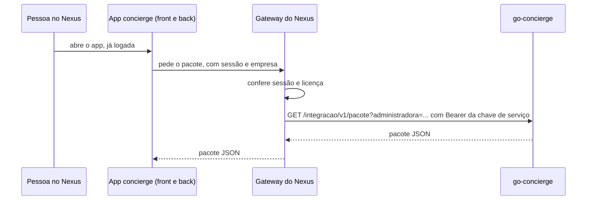

# Integração com o app concierge do Nexus

O app concierge do Nexus é a tela de administração; o go-concierge é quem executa a conversa. Este documento descreve como o Nexus lê o que o go-concierge tem e envia o mapeamento de administradoras e condomínios.

## tltr

- `GET /integracao/v1/pacote` traz tudo que o Nexus precisa enxergar.
- `PUT /integracao/v1/mapeamento` grava administradoras, condomínios, habilitações, orientações e payloads.
- Memória e pedidos de um morador saem por consulta, sempre de uma administradora (`/memorias`, `/memoria`, `/pedidos`).
- Quem chama é o gateway do Nexus, não o navegador. O gateway autentica a pessoa e manda a chave de serviço; o go-concierge não fala com provedor de identidade.
- Sem `INTEGRACAO_CHAVE` configurada, nenhuma rota existe (404).
- Dado de morador não vai em lote nem no pacote.

## Fluxo



O gateway guarda a chave e a injeta na chamada, como já faz com outros serviços que ele repassa. A chave nunca chega ao navegador nem ao back do app.

## Rota

```
GET /integracao/v1/pacote
GET /integracao/v1/pacote?administradora=<id>
Authorization: Bearer <INTEGRACAO_CHAVE>
```

| Resposta | Quando |
|---|---|
| 200 | pacote JSON |
| 400 | `administradora` com formato inválido |
| 401 | sem `Authorization`, sem o esquema `Bearer` ou chave errada |
| 404 | `INTEGRACAO_CHAVE` vazia: rota desligada |

- `administradora` recorta o mapeamento e as regras dos ganchos para ela (mais as regras globais). O catálogo é global e vai inteiro.
- Com `ADMINISTRADORA_ID` fixo na implantação, o recorte é sempre o dela.
- A rota não passa pelo RBAC de usuário: `X-Dev-Usuario` não a abre.

## Pacote (versão 1)

| Campo | O que traz |
|---|---|
| `versao` | 1. Muda quando um campo some ou troca de sentido; campo novo não muda |
| `gerado_em` | instante da leitura, em UTC |
| `agentes` | árvore do catálogo: orquestrador e subagentes, com tipo, modelo, recursos declarados, config do `agent.yaml`, índice de arquivos e o caso de uso lido |
| `arquivos` | todo arquivo de `agentes/`, com o conteúdo como está no disco: `agent.yaml`, `persona.md`, `caso.yaml`, regras, workflows, rotas, conhecimento, assets, evals |
| `casos_de_uso` | lista plana das skills que o morador alcança: nome, título, descrição, se grava, recursos que usa |
| `recursos` | ferramentas e conteúdos do condomínio: nome, tipo, se grava, parâmetros, saída, amostra |
| `mapeamento` | administradoras, condomínios (com `account`, `company_id`, `tenant`), habilitações por condomínio, orientações e payloads |
| `papeis` | os 4 papéis, de quem herdam e as permissões de cada um |
| `ganchos` | `fixos` por evento e as `regras` declarativas |

Arquivo em `arquivos`:

| Campo | Sentido |
|---|---|
| `caminho` | relativo à raiz do catálogo, com barras |
| `conteudo` | texto cru; binário em base64 |
| `codificacao` | `base64` quando o conteúdo não é UTF-8 |
| `omitido` | motivo, quando o arquivo passa de 1 MiB e vai sem conteúdo |

Pastas e arquivos ocultos ficam fora.

## Escrever o mapeamento

```
PUT /integracao/v1/mapeamento
PUT /integracao/v1/mapeamento?administradora=<id>
Authorization: Bearer <INTEGRACAO_CHAVE>
```

```json
{
  "administradoras": [{"id": "adm-x", "nome": "X"}],
  "condominios": [{"id": "cond-1", "nome": "Um", "administradora_id": "adm-x", "account": "", "company_id": "", "tenant": ""}],
  "habilitacoes": {"cond-1": {"boleto": {"habilitado": true, "papeis": []}}},
  "orientacoes": {"cond-1": {"geral": "", "por_caso": {}}},
  "payloads": {"cond-1": {"recurso.nome": {}}},
  "remover": {"condominios": [], "administradoras": [], "habilitacoes": {"cond-1": ["boleto"]}}
}
```

Os campos têm a forma do `mapeamento` do pacote: ler, editar e devolver funciona. Todos são opcionais. `"*"` em `habilitacoes`, `orientacoes` e `payloads` é o padrão de todos os condomínios. Payload `null` apaga o do recurso; orientação sem texto apaga a do condomínio. Campo desconhecido no corpo é recusado.

| Resposta | Quando |
|---|---|
| 200 `{"aplicados": n}` | tudo gravado |
| 400 | corpo ou campo inválido, id repetido no lote, mais de 500 itens |
| 403 | item fora do recorte; nada foi gravado |
| 409 | conflito de regra (ex.: remover administradora que ainda tem condomínio), id que apareceu no meio |
| 413 | corpo acima de 1 MiB |
| 503 | outra escrita do mapeamento aconteceu ao mesmo tempo; reenviar |

- **Ordem.** Administradoras, condomínios, habilitações, orientações, payloads e, por último, remoções (habilitações, condomínios, administradoras).
- **Validação antes de gravar.** O lote inteiro é conferido (formato, recorte e as regras do Studio contra uma cópia) antes do primeiro item. Erro previsível não deixa o lote pela metade.
- **Sem transação única.** Cada item é uma escrita própria. Se um falha no meio, a resposta traz `aplicados` (quantos passaram) e `falhou` (qual item, ex.: `condominios[cond-1]`), e o erro vem no mesmo formato das demais rotas.
- **Reenviar é seguro.** Os itens são upserts e remover o que já não existe não é erro: o mesmo lote duas vezes deixa o mesmo estado.
- **Recorte.** Com `?administradora=<id>` (ou `ADMINISTRADORA_ID` fixo na implantação, que vence o parâmetro), só entram a própria administradora, condomínios dela e o que é deles. Fora do recorte: outra administradora, o padrão `*`, condomínio de outra (inclusive um existente que o corpo tentaria tomar) e `company_id`/`tenant`, que decidem o roteamento das mensagens e só mudam sem recorte, como no Studio. Sem recorte, vale tudo.
- **Efeito no turno.** A escrita passa pelo mesmo repositório do Studio e atualiza o cache de mapeamento que o turno lê, sem reiniciar. A leitura seguinte do pacote já traz o novo estado.

## Dado de morador

| Rota | Traz |
|---|---|
| `GET /integracao/v1/memorias?administradora=` | contatos com memória |
| `GET /integracao/v1/memoria?administradora=&phone=` | fatos de um contato |
| `DELETE /integracao/v1/memoria?administradora=&phone=[&chave=]` | esquece um fato ou todos |
| `GET /integracao/v1/pedidos?administradora=&phone=` | carteira de pedidos do contato |

`administradora` é obrigatória (400 sem ela; com `ADMINISTRADORA_ID` fixo vale a fixa e outra dá 403). Memória e pedidos são guardados por administradora e telefone, então outra administradora não enxerga o contato. `DELETE` de uma `chave` que não existe responde 404. O telefone da consulta sai mascarado do log, como nas rotas `/api`.

## Configuração

```
INTEGRACAO_CHAVE=<segredo gerado, 32 caracteres ou mais>
```

O boot recusa chave com menos de 32 caracteres. Gerar: `openssl rand -hex 32`.

## Fora desta versão

- **Escrita do catálogo.** Editar skill, caso de uso e arquivo segue pelo Studio.
- **Conversas.** Sessões e transcrições não saem pela integração.
- **Licença do Nexus.** A administradora daqui ainda não guarda o id da licença do Nexus; quem chama passa o id da administradora do go-concierge.
- **Catálogo em arquivo.** As skills ainda moram em `okf/`. O pacote lê do disco; quando o catálogo for para o Postgres, o contrato não muda.
