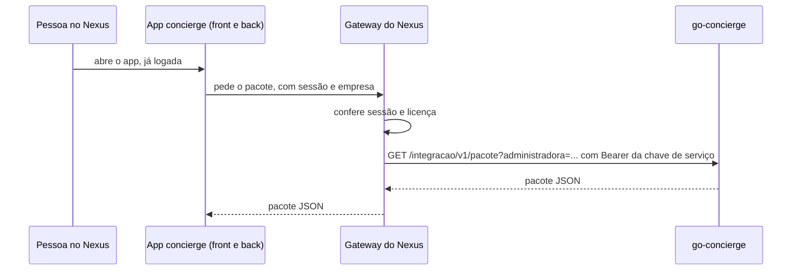

# Integração com o app concierge do Nexus

O app concierge do Nexus é a tela de administração; o go-concierge é quem executa a conversa. Este documento descreve como o Nexus lê o que o go-concierge tem.

## tltr

- Uma rota só: `GET /integracao/v1/pacote`, com tudo que o Nexus precisa enxergar.
- Quem chama é o gateway do Nexus, não o navegador. O gateway autentica a pessoa e manda a chave de serviço; o go-concierge não fala com provedor de identidade.
- Sem `INTEGRACAO_CHAVE` configurada, a rota não existe (404).
- Dado de morador (conversas, memória, pedidos) fica fora do pacote.

## Fluxo



O gateway guarda a chave e a injeta na chamada, como já faz com outros serviços que ele repassa. A chave nunca chega ao navegador nem ao back do app.

## Rota

```
GET /integracao/v1/pacote
GET /integracao/v1/pacote?administradora=<id>
Authorization: Bearer <INTEGRACAO_CHAVE>
```

| Resposta | Quando |
|---|---|
| 200 | pacote JSON |
| 400 | `administradora` com formato inválido |
| 401 | sem `Authorization`, sem o esquema `Bearer` ou chave errada |
| 404 | `INTEGRACAO_CHAVE` vazia: rota desligada |

- `administradora` recorta o mapeamento e as regras dos ganchos para ela (mais as regras globais). O catálogo é global e vai inteiro.
- Com `ADMINISTRADORA_ID` fixo na implantação, o recorte é sempre o dela.
- A rota não passa pelo RBAC de usuário: `X-Dev-Usuario` não a abre.

## Pacote (versão 1)

| Campo | O que traz |
|---|---|
| `versao` | 1. Muda quando um campo some ou troca de sentido; campo novo não muda |
| `gerado_em` | instante da leitura, em UTC |
| `agentes` | árvore do catálogo: orquestrador e subagentes, com tipo, modelo, recursos declarados, config do `agent.yaml`, índice de arquivos e o caso de uso lido |
| `arquivos` | todo arquivo de `agentes/`, com o conteúdo como está no disco: `agent.yaml`, `persona.md`, `caso.yaml`, regras, workflows, rotas, conhecimento, assets, evals |
| `casos_de_uso` | lista plana das skills que o morador alcança: nome, título, descrição, se grava, recursos que usa |
| `recursos` | ferramentas e conteúdos do condomínio: nome, tipo, se grava, parâmetros, saída, amostra |
| `mapeamento` | administradoras, condomínios (com `account`, `company_id`, `tenant`), habilitações por condomínio, orientações e payloads |
| `papeis` | os 4 papéis, de quem herdam e as permissões de cada um |
| `ganchos` | `fixos` por evento e as `regras` declarativas |

Arquivo em `arquivos`:

| Campo | Sentido |
|---|---|
| `caminho` | relativo à raiz do catálogo, com barras |
| `conteudo` | texto cru; binário em base64 |
| `codificacao` | `base64` quando o conteúdo não é UTF-8 |
| `omitido` | motivo, quando o arquivo passa de 1 MiB e vai sem conteúdo |

Pastas e arquivos ocultos ficam fora.

## Configuração

```
INTEGRACAO_CHAVE=<segredo gerado, 32 caracteres ou mais>
```

O boot recusa chave com menos de 32 caracteres. Gerar: `openssl rand -hex 32`.

## Fora desta versão

- **Escrita.** O pacote é só leitura. Editar skill, habilitar condomínio e criar regra seguem pelo Studio.
- **Dado de morador.** Conversas, memória e pedidos saem por consulta recortada por administradora, não em lote.
- **Licença do Nexus.** A administradora daqui ainda não guarda o id da licença do Nexus; quem chama passa o id da administradora do go-concierge.
- **Catálogo em arquivo.** As skills ainda moram em `okf/`. O pacote lê do disco; quando o catálogo for para o Postgres, o contrato não muda.
