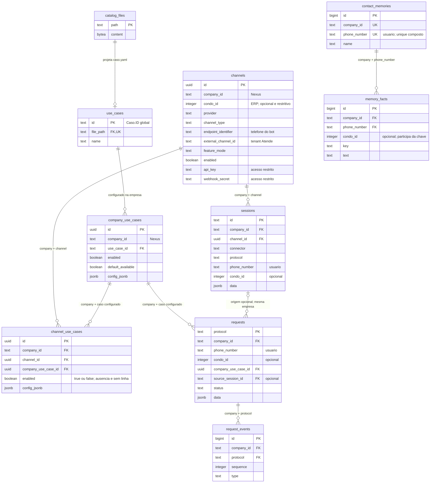
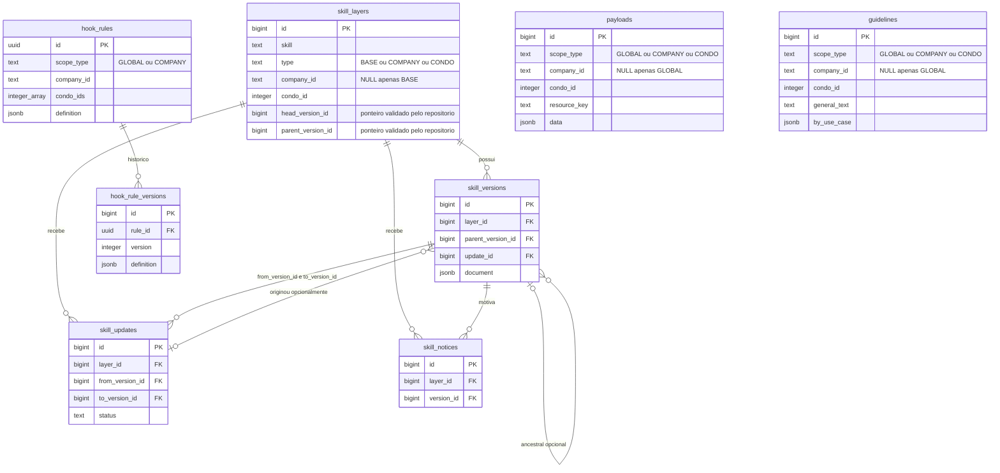
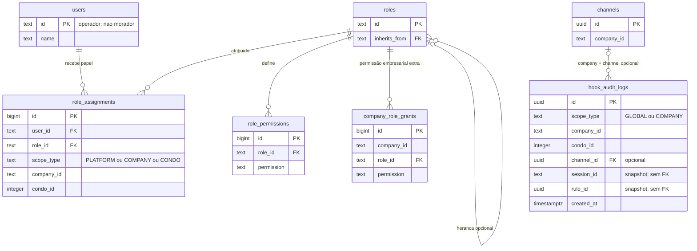

# Diagramas do banco v2

Data: 18/11/2026. Leia junto com o [desenho principal](README.md) e o [dicionário](DICIONARIO.md).

Os diagramas mostram apenas campos essenciais. As relações sólidas representam FKs materializadas na [baseline isolada](../../../internal/banco/v2/migrations/00001_baseline.sql); as pontilhadas de origem não substituem o detalhamento textual. Não existe tabela local de empresa ou condomínio. O runtime ainda usa o banco legado.

## 1. Catálogo, canal e atendimento

Não existe FK obrigatória entre sessão e contato, nem entre pedido e contato: processar um atendimento/pedido não depende de já haver memória persistida. A ausência dessa FK não remove o filtro de empresa + usuário.

Os FKs marcados nos campos empresariais são compostos. Por exemplo, vínculo de canal referencia `(company_id, channel_id)`, e não só `channel_id`. Veja todas as chaves únicas no dicionário.

## 2. Configuração e versionamento

`head_version_id` e `parent_version_id` em `skill_layers` mantêm a abordagem atual de ponteiros validados no repositório. As FKs entre versões não provam sozinhas que o ancestral pertence à skill/empresa correta: publicação e atualização validam o conjunto em transação.

A empresa das tabelas filhas é obtida por join com sua camada/regra. Uma API que recebe apenas o ID da versão ainda precisa autorizar o proprietário.

## 3. Acesso e auditoria

Auditoria de turno sempre pertence a uma empresa. IDs de sessão/regra são snapshots de correlação, sem FK de retenção; não são credenciais de acesso. Usuários e papéis são definições da operação, não cadastros de empresas nem de moradores.

O diagrama de acesso representa capacidades de autorização a adaptar. Ele não determina a jornada de login/perfis dos frontends nem replica a navegação atual no plugin. O backdoor será um frontend de operação da plataforma, incluindo console/emulador; o plugin na interface Nexus será a gestão do recurso pela empresa cliente. Ambos usam o mesmo backend, que autoriza cada operação e mantém a propriedade empresarial dos dados. Veja as [fronteiras das aplicações](README.md#fronteiras-das-aplicações-e-públicos).
