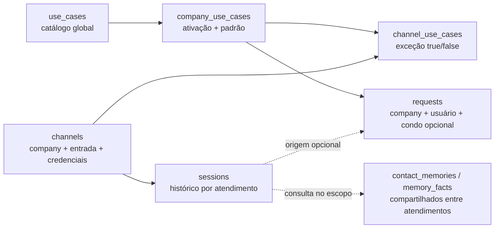

# Desenho do banco do Concierge — v2

Data: 18/11/2026. Branch: `feat/refactor-identidade-canais-db`.

**Status: backend v2 em uso.** O modelo canônico de 24 tabelas, 197 campos e 24 FKs está materializado nos [schemas Ent v2](../../../internal/banco/v2/ent/schema) e na [baseline Goose](../../../internal/banco/v2/migrations/00001_baseline.sql), usada pelo bootstrap e pelo runtime em um banco novo dedicado. Nenhum banco legado ou volume preexistente foi substituído. Canais e ativações são configurados por SQL/seed nesta etapa; o Console consulta esses dados. As camadas publicadas compõem o conteúdo usado pelo runtime. Veja [runtime no banco v2](../../../internal/banco/v2/RUNTIME.md) e a [documentação técnica](../../../internal/banco/v2/README.md).

## Como ler

- [Diagramas de relacionamentos](DIAGRAMAS.md): catálogo/canais/atendimento, configuração e acesso.
- [Dicionário completo](DICIONARIO.md): campos, tipos, propriedade, chaves, FKs, índices e validações.
- [Alcance do backdoor por tabela](BACKDOOR.md): edição de conteúdo/fluxos, configuração e operação; distingue telas, APIs e capacidades ainda não integradas.
- [Mapa histórico das 23 tabelas legadas](MAPA-ATUAL.md): correspondência da modelagem anterior com o modelo v2.
- [Modelo em JSON](modelo.json): representação estruturada do desenho materializado; não é schema de request nem DDL.

O ponto de partida é: **empresa Nexus possui os dados empresariais; canal configura a entrada do atendimento; condomínio restringe o contexto aplicável; o usuário identifica a carteira pessoal.**

## 1. Alinhamentos incorporados

- `company_id` é a identificação **string da empresa Nexus**, obrigatória nos dados de empresa. Não criar tabela local de administradoras/empresas.
- `condo_id` é **integer do condomínio no ERP**, opcional. Não criar cadastro local de condomínios nem FK para o ERP.
- `channel_id` é UUID estável do cadastro de canal. Tenant Atende, telefone do canal e telefone do usuário são identidades distintas.
- Um backend compartilhado sustenta backdoor interno e plugin cliente na interface **Nexus**. Gestão de configuração é uma jornada administrativa; runtime a consome.
- Caso de uso é o item de catálogo que o outro projeto chama de funcionalidade. Catálogo global, configuração empresarial e override de canal são camadas diferentes.
- Variantes procedurais realmente diferentes são casos com IDs distintos.
- A política de disponibilidade do gateway é preservada.
- Tabelas, colunas e valores técnicos da nova modelagem são padronizados em inglês; interfaces continuam em pt-BR.
- Sessão continua sendo um atendimento por canal/conector/protocolo. Memória e pedidos pertinentes podem atravessar sessões e canais da mesma empresa, para o mesmo usuário.
- Canal estrito de Alpha limita **todo contexto do atendimento a Alpha**. Não pode alcançar Beta pela memória, carteira, ferramenta, cache ou JSON da sessão.
- Registros de atendimento com `condo_id = null` podem continuar sendo salvos. Não exigir preenchimento nem reclassificar automaticamente os dados agora; avaliar os fluxos na suíte posterior.
- Credenciais por canal serão salvas e usadas nesta fase; cifra está adiada conforme orientação do usuário.
- Os dados atuais são descartáveis. A estratégia será banco novo com baseline versionada, sem migração dos registros antigos.
- A entrega atual não remodela prompts nem implementa a integração operacional com o plugin.

### Fronteiras das aplicações e públicos

O destino é **um backend compartilhado e dois frontends separados**, com jornadas e permissões próprias:

| Aplicação | Público e responsabilidade |
|---|---|
| `concierge-back` | Núcleo compartilhado: persistência, camadas de skills, sessões, memória, pedidos, ganchos, runtime Eino + OKF, integrações ATENDE/Gruvi/Nexus e APIs consumidas pelos frontends. |
| `apps/backdoor` | Operação interna da plataforma: Studio, editor de fluxos, copiloto, gestão técnica e ganchos; frontend e API próprios. |
| `apps/console` | Atendimento e testes internos: Console/emulador com frontend e API próprios; integra-se por HTTP ao Concierge. |
| `concierge-plugin` | Gestão do recurso pela empresa cliente, na interface Nexus: configurar canais, consultar os casos disponíveis e controlar sua ativação na empresa/canais conforme a política definida. |

O console/emulador pertence à jornada de operação interna. A navegação atual por administradora/condomínio e as futuras visões por empresa/condomínio são recortes de trabalho; não determinam que essas telas sejam a jornada do cliente nem que devam ser reproduzidas no plugin.

Na modelagem, separar **quem opera** de **quem é dono do dado**. Um operador da plataforma pode atuar sobre uma empresa para a qual tenha autorização; o registro continua pertencendo ao `company_id` Nexus dessa empresa. O escopo empresarial e condominial continua obrigatório mesmo nas operações internas. Ter acesso ao backdoor não concede acesso irrestrito aos dados.

As tabelas de usuários, papéis, atribuições e concessões preservam capacidades de autorização existentes para revisão na adaptação; não fixam agora a experiência de login/perfis dos dois frontends. A matriz de alcance do backdoor descreve capacidades atuais, sem concedê-las automaticamente ao plugin. A menção ao mapeamento legado de administradoras/condomínios não reintroduz seus cadastros locais no novo banco.

### Convenção de nomenclatura aprovada

- Tabelas no plural e identificadores em inglês, com `snake_case`; colunas de referência seguem `*_id`.
- Datas usam nomes como `created_at`, `updated_at` e `occurred_at`. Valores de enums controlados pela aplicação usam inglês em `UPPER_SNAKE_CASE`.
- Nomes de constraints e índices seguem a mesma convenção na baseline.
- Textos das interfaces e explicações permanecem em pt-BR. O domínio interno em Go pode manter nomes em português, mapeados na camada de persistência.
- IDs estáveis de casos, chaves de recursos, nomes de arquivos existentes como `caso.yaml`, valores de provedores e payloads externos seguem seus contratos; não serão traduzidos mecanicamente.
- O inglês também orienta os contratos técnicos próprios persistidos em JSONB; a definição desses DTOs fica para a adaptação do código, preservando textos livres e dados de integrações.

## 2. Estrutura central



As setas resumem o uso dos dados. FKs e cardinalidades estão nos [diagramas detalhados](DIAGRAMAS.md).

### Catálogo global: `use_cases`

Um registro por `Caso.ID`, estável e globalmente único. Nome não é identificador. O mesmo catálogo é consultável pelas empresas conforme a visibilidade já existente, sem copiar uma definição para cada empresa.

**Recomendação:** esta tabela é um índice relacional derivado dos arquivos `caso.yaml`, cujo conteúdo canônico já vive em `catalog_files`. Metadados projetados e conteúdo são atualizados na mesma transação. Procedimento, passos e parâmetros não passam a ter uma segunda definição editável.

Na listagem administrativa, o catálogo pode ser combinado por LEFT JOIN com a configuração da empresa. Assim é possível mostrar também casos ainda não configurados para ela.

### Configuração empresarial: `company_use_cases`

Uma linha por `(company_id, use_case_id)`, com:

- `enabled`: bloqueio/permissão do caso na empresa.
- `default_available`: inclusão no padrão seguido pelos canais.
- `roles`: preserva o filtro atual por papéis de execução, sem confundir com acesso do operador ao backdoor.
- `config_jsonb`: parâmetros empresariais, sem copiar o procedimento global.

Seu UUID pode ocupar o papel de `feature_id` no contrato administrativo; `use_cases.id` ocupa o de identidade global/`feature_key`. Esse mapeamento é uma proposta de contrato, não compatibilidade automática com IDs da implementação anterior.

**Decisão aprovada pelo usuário:** ausência de linha empresarial significa “ainda não configurado/ativado”. O item continua no catálogo global, mas não fica disponível para execução por essa empresa. Criar a linha exige os valores explícitos de `enabled` e `default_available`; não inferir um padrão universal da origem.

Essa decisão mudou o default implícito do runtime legado: [admin.Habilitado](../../../internal/admin/admin.go) permitia o caso quando não encontrava configuração. O runtime v2 aplica a ausência de configuração empresarial como caso ainda não ativado.

### Canal e override: `channels` e `channel_use_cases`

`channels` reúne empresa, condomínio restritivo opcional, perfil, provider/tipo, telefone de entrada, tenant externo, modo, estado, agente raiz e credenciais. Não criar outro `nexus_channel_id` espelhando o mesmo UUID.

`channel_use_cases` aponta para a configuração empresarial, com FKs compostas por empresa tanto para o canal quanto para o caso configurado. Assim, o banco impede vincular canal de A à configuração de B.

O vínculo contém `enabled` booleano **não nulo**. Não existir linha é diferente de existir uma linha com false. O JSON do vínculo é preservado ao mudar só o booleano; a resolução atual não o mescla com o JSON empresarial.

## 3. Onde cada identificador participa

| Dado | Empresa | Usuário | Condomínio | Canal |
|---|---|---|---|---|
| Catálogo de casos e arquivos base | Global explícito | — | — | — |
| Configuração do caso na empresa | Obrigatória | — | — | — |
| Cadastro de canal | Obrigatória | — | Restrição opcional | Identidade própria |
| Override de caso por canal | Obrigatória | — | Obtido pelo canal, sem nova herança | Obrigatório |
| Sessão | Obrigatória | Telefone obrigatório | Contexto opcional | Obrigatório |
| Cabeçalho de memória do contato | Obrigatória | Telefone obrigatório | — | — |
| Fato de memória | Obrigatória | Telefone obrigatório | Opcional; participa da chave lógica | Não divide a memória |
| Pedido | Obrigatória | Telefone obrigatório | Opcional | Origem indireta e opcional pela sessão |
| Evento de pedido | Obrigatória | Obtido pelo pedido | Obtido pelo pedido | Sem nova dimensão obrigatória |
| Payloads, orientações e camadas de skill | Empresa ou base global explícita | — | Personalização opcional | Sem camada nova por canal |
| Versões, atualizações e avisos de skill | Herdada da camada via join | — | Herdado | — |
| Regra de gancho | Empresa ou global explícito | — | Lista opcional de alvos ERP | Sem camada nova por canal |
| Histórico de regra | Herdado da regra via join | — | Herdado | — |
| Auditoria de gancho | Obrigatória nos eventos empresariais | Não guarda telefone | Quando conhecido | Quando conhecido |
| Usuários operadores, papéis e permissões base | Definição global | Operador, não morador | — | — |
| Atribuição de acesso | Plataforma ou empresa explícita | Operador | Opcional | — |
| Concessão de permissão | Obrigatória | Por papel | — | — |

A memória do contato não vira um cadastro de vínculos ERP. Seu nome é identificação básica; fatos contextuais pertencem a `memory_facts`.

Dados base globais e definições compartilhadas não recebem uma empresa fictícia. Nos registros que misturam base e personalização, um discriminador e CHECK distinguem GLOBAL/COMPANY/CONDO. Nos filhos de uma camada/regra, a empresa deriva do proprietário e precisa entrar no JOIN de autorização. Isso mantém a propriedade empresarial sem repetir `company_id` em toda revisão.

Essas personalizações de conteúdo/configuração pertencem à gestão interna no backdoor. O backend persiste e, quando houver versionamento/publicação, disponibiliza a composição publicada ao agente em execução. Exemplo conceitual: orientação base compartilhada, orientação da empresa e orientação específica de Alpha. **Decisão aprovada pelo usuário:** manter os níveis base global → empresa → condomínio, sem acrescentar um nível próprio de personalização de conteúdo por canal nesta fase. Essa composição é distinta de INHERIT/CUSTOM/EXPLICIT, que governa a seleção das funcionalidades.

## 4. Compartilhamento e restrição do atendimento

Exemplo ilustrativo: empresa Nexus `empresa-a`, mesmo usuário, canal ADM sem condomínio fixo e canal Alpha com `condo_id = 101`.

| Registro/contexto | Consulta ampla no ADM | Consulta no canal Alpha |
|---|---|---|
| Pedido Alpha iniciado no ADM | Encontra | Encontra |
| Pedido Alpha iniciado no canal Alpha | Encontra | Encontra |
| Fato/pedido Beta da mesma pessoa/empresa | Pode encontrar no contexto amplo | Excluído |
| Fato/pedido de outra pessoa | Excluído da consulta pessoal | Excluído |
| Fato/pedido de outra empresa | Excluído | Excluído |
| Fato/pedido com condo NULL | Pode existir e ser lido no escopo amplo | Não entra automaticamente como fallback |
| Histórico da sessão no ADM | Pertence ao atendimento do ADM | Não é copiado como histórico da sessão Alpha |

Predicados conceituais de consulta pessoal:

```sql
-- Atendimento amplo, sem recorte condominial ativo
WHERE company_id = :company_id
  AND phone_number = :user_phone_number

-- Atendimento restrito a Alpha
WHERE company_id = :company_id
  AND phone_number = :user_phone_number
  AND condo_id = :alpha_condo_id
```

As duas leituras partem do canal e da identidade validados pelo servidor. São exemplos de predicados, não queries aplicadas nesta entrega. A identidade básica do contato é consultada por empresa + telefone; o recorte acima governa os fatos e pedidos contextualizados.

`condo_id = null` não é curinga. O desenho permite persistir esse valor sem decidir agora uma nova semântica universal. Para a restrição já alinhada, dados sem condomínio não podem ser usados para ampliar silenciosamente o contexto de Alpha.

**Chave proposta dos fatos:** `(company_id, phone_number, condo_id, key)`, com NULLS NOT DISTINCT. Isso permite a mesma chave em Alpha e Beta, além de uma eventual linha sem condomínio, sem que uma sobrescreva a outra.

**Escrita respeita o recorte:** o código atual substitui coleções de memória/pedidos e pode apagar itens ausentes. Na adaptação, gravar o recorte Alpha precisa atualizar apenas esse recorte ou usar deltas por registro. Não pode excluir Beta só porque Beta não veio na leitura.

### Invariante obrigatório: preservar dados fora do alvo

**Nenhuma gravação ou exclusão pode apagar ou alterar dados fora do alvo autorizado.** Este é um requisito obrigatório da implementação, incluindo as funcionalidades que serão adaptadas ao banco novo. Salvar Alpha deve preservar Beta, outra empresa e outro usuário.

- Toda escrita empresarial aplica `company_id` autorizado; dados pessoais também aplicam usuário e recorte condominial quando pertinente. Operações de canal/configuração preservam os outros canais, casos e escopos fora do alvo. Filhos de camadas/regras exigem autorização pelo proprietário.
- Coleção filtrada, paginada, parcial ou vazia não representa automaticamente todos os dados persistidos. Sua ausência no payload não autoriza excluir um registro fora do alvo. Preferir deltas por registro ou uma substituição estritamente limitada ao conjunto autorizado e explicitamente definido pela operação.
- O cuidado inclui `INSERT`/upsert, `UPDATE`, `DELETE`, cascatas, sincronização, importação, esquecer memória, cancelar/remover pedidos e resetar sessão; também inclui coleções embutidas em JSON. Salvar uma personalização não sobrescreve a base global nem outra personalização.
- A regra permite exclusões explícitas e autorizadas do próprio alvo. Um reset de sessão, por exemplo, não autoriza apagar a carteira compartilhada de pedidos.
- A futura suíte deve provar a preservação com Alpha/Beta, outra empresa e outro usuário, inclusive em salvamento de coleção vazia, alteração de item e exclusão explícita. Deve verificar o estado persistido, além das listas retornadas. **A implementação não estará concluída se esses testes falharem.**

“Substituição de coleções” aqui significa conjuntos de dados persistidos no banco; não significa excluir arquivos físicos.

A sessão guarda o histórico do atendimento atual. Um pedido não é fragmentado por canal: a sessão de origem registra proveniência, sem ser filtro de visibilidade. Se um reset remover a sessão, a proposta é limpar apenas essa referência opcional e manter o pedido.

Recordar um pedido não concede execução de uma ação: disponibilidade atual da funcionalidade e autorização do usuário continuam sendo verificadas.

## 5. Política de disponibilidade preservada

Considere `override` igual ao booleano do vínculo, ou null se a linha não existe:

| Modo do canal | Seleção antes dos bloqueios |
|---|---|
| INHERIT | `company_use_case.default_available`; ignora vínculos preservados |
| CUSTOM | `override ?? company_use_case.default_available` |
| EXPLICIT | `override === true` |

```text
available = channel.enabled && company_use_case.enabled && selected
```

A expressão se aplica aos casos que têm configuração empresarial. Ausência dessa configuração segue a decisão aprovada descrita na seção 2.

- Bloqueio empresarial vence override positivo. Canal desligado também resulta em lista efetiva vazia.
- `enabled` e `default_available` da empresa são controles independentes.
- Troca de modo não apaga os vínculos. INHERIT pode conter vínculos sem efeito.
- Restaurar o padrão em CUSTOM remove a linha; não grava o booleano atual do padrão.
- False em EXPLICIT continua persistido e mantém sua semântica ao trocar para CUSTOM.
- Mutation com null remove linha e JSON; mutation do booleano preserva o JSON existente.
- Canal desligado permite preparar a configuração.
- O condomínio do canal não cria outra camada de herança de funcionalidades.
- `requires_condo`, se exposto no contrato de catálogo, não filtra a lista do canal geral; condomínio pode ser resolvido durante a conversa.
- Preservar escrita por deltas atômicos, validação de `expected_mode`, recusa de escrita em INHERIT e de inclusão positiva quando o caso está bloqueado na empresa.
- `expected_mode` detecta troca de modo; não resolve sozinho duas edições concorrentes no mesmo modo.

O backend compartilhado pode executar essa regra diretamente para gestão e runtime. Este modelo não exige chamada Go → gateway e não presume que a autenticação administrativa atual do gateway sirva para M2M.

## 6. Fluxos sustentados pelo modelo

### Setup

Na etapa atual do refactor, preparar canal, credenciais e configurações de disponibilidade diretamente por SQL/seed no banco novo. As novas APIs e telas de gestão ficam explicitamente para uma entrega futura. O runtime precisa consumir os dados persistidos e fornecer ao agente o contexto necessário, sem depender dessas interfaces para funcionar.

Os passos abaixo descrevem a jornada futura pelo plugin, não uma exigência de implementá-la junto do refactor:

1. Pessoa autorizada da empresa acessa o plugin no Nexus; backend valida autenticação e acesso à empresa.
2. Catálogo comum é combinado com configurações empresariais. A empresa configura bloqueios e padrão.
3. Cadastro de canal associa o UUID a essa empresa, provider, tenant externo, telefone, condo opcional, perfil e credenciais.
4. Canal escolhe INHERIT/CUSTOM/EXPLICIT; CUSTOM/EXPLICIT podem gravar overrides do catálogo configurado na empresa.
5. Runtime usa a configuração persistida. A habilitação administrativa não substitui a checagem dos campos operacionais necessários ao provider.

O código de origem do plugin ainda tem credenciais apenas visuais. Transportar a tela não implementa a persistência delas: a futura adaptação precisará gravá-las pelo backend sem devolvê-las nas listagens. Não haverá segunda autoridade de ativação mantida em paralelo.

### Mensagem recebida do Atende

1. Identidade externa do webhook localiza exatamente um canal por provider/tipo/tenant/telefone do bot. Ambiguidade é erro, nunca escolha da primeira linha.
2. Backend usa o secret desse canal para validar a assinatura e verifica habilitação/prontidão antes de iniciar o atendimento.
3. A partir do canal validado, obtém `company_id` e eventual restrição de condomínio. A mensagem não escolhe livremente outra empresa.
4. Localiza a sessão por canal/conector/protocolo e identifica o usuário.
5. Resolve casos disponíveis e lê memória/pedidos com empresa + usuário + recorte condominial aplicável.
6. Executa o runtime existente e persiste os dados no mesmo escopo, sem substituição destrutiva de outros recortes.
7. Envia resposta usando tenant, endpoint e API key do próprio canal.

Configurações comuns da infraestrutura podem continuar no ambiente. Os valores que identificam/credenciam um tenant específico pertencem ao cadastro de canal.

## 7. Integridade e decisões técnicas propostas

Estas são recomendações concretas para revisão, além das regras de produto já alinhadas:

| Escolha proposta | Motivo / limite |
|---|---|
| Índice relacional derivado de caso.yaml | Permite relacionamentos fortes sem duas definições executáveis editáveis |
| Ausência de configuração empresarial = não ativado (aprovado) | Catálogo global continua listável; mudança do default implícito permissivo do Go atual aprovada para implementação |
| Mesmo UUID de canal para plugin e backend | Evita mapeamento redundante entre dois IDs do mesmo cadastro |
| Unicidade de canal por empresa/provider/endpoint e unicidade operacional global por provider/tipo/tenant/endpoint | Preserva regra da origem e impede webhook apontando para duas empresas; revisar com o payload real na implementação |
| FKs compostas de empresa nos vínculos, sessão e pedidos | Impedem relações locais entre empresas diferentes |
| Company/condo restritivo/identidade operacional do canal não mudam após uso (aprovado por ora) | Evita reatribuir o histórico; mudanças que alterem esses vínculos criam outro cadastro |
| Sessão de origem do pedido opcional; exclusão limpa só a referência | Preserva reset sem apagar a carteira; SET NULL da coluna específica exige suporte do PostgreSQL/geração |
| Escopos globais explícitos em configuração e acesso | Mantém bases compartilhadas sem empresa fictícia nem linhas empresariais sem dono |
| Payloads/orientações: composição GLOBAL → COMPANY → CONDO | Adapta a hierarquia existente; não cria personalização nova por canal nem altera textos |
| Propriedade das revisões herdada por camada/regra | Evita colunas redundantes; exige joins autorizados e validação transacional de ancestralidade |
| Fatos únicos por empresa/usuário/condo/chave | Evita colisão entre fatos homônimos de Alpha e Beta |
| Sem tabela nova de thread/mensagem | Mantém o histórico na sessão serializada, como hoje |

Company, canal e contexto não vêm de um campo livre do frontend. Devem ser derivados/validados no contexto autenticado. Consultas empresariais sempre filtram company, inclusive quando recebem um UUID próprio, consultam filhos ou fazem acesso direto por protocolo.

No modo Nexus/PostgREST, preservar contexto de banco autorizado e RLS junto dos filtros explícitos. No acesso PostgreSQL do Go, definir/aplicar o contexto equivalente conforme o papel utilizado; não presumir RLS instalada ou eficaz para um papel que a contorne.

FKs não substituem todos os invariantes: ancestralidade das skills, coerência dos snapshots/JSONs e restrição condominial da sessão exigem validação transacional no repositório. Acesso a globais precisa ser explícito; evento de atendimento sem empresa resolvida não vira evento global para contornar essa exigência.

## 8. Limites e transição para implementação

Não estamos incorporando nesta etapa todo o modelo antigo de FORM, recursos externos ou seus enums. Os casos de uso existentes são o ponto de partida; metadados extras do contrato de catálogo só entram quando forem necessários e tiverem fonte definida.

Também ficam para as respectivas integrações: semântica de `account_id` enviado ao Nexus, eventual company Gruvi, autenticação M2M quando houver chamada entre serviços, operação de rotação de credenciais e integração visual do plugin. O `company_id` Nexus dono dos registros já está definido e não depende dessas respostas.

### Banco v2 e runtime

A baseline está versionada e é aplicada pelo bootstrap a um banco PostgreSQL 18 novo e dedicado. A aplicação recusa tabelas legadas e não transforma registros antigos; consulte [runtime no banco v2](../../../internal/banco/v2/RUNTIME.md) para preparação e operação.

### Sequência do refactor e evolução do backdoor

O backend e o frontend atual foram adaptados ao novo modelo nesta branch, preservando as capacidades pertinentes. Backdoor e Console agora possuem aplicações próprias no monorepo, conforme [Separação das aplicações](SEPARACAO-APLICACOES.md). A revisão mais ampla da experiência continua sendo uma etapa futura.

Isso não obriga a manter cada tela ou formulário legado. Telas vinculadas aos cadastros locais de administradora/condomínio precisarão ser adaptadas ou retiradas conforme sua responsabilidade no novo modelo, sem reintroduzir essas entidades para manter a interface antiga. A revisão posterior definirá a organização do backdoor para Professional Services e operadores da plataforma; o plugin mantém a jornada própria de gestão do recurso pela empresa.

Persistência, runtime, integrações e autorização ficam no backend, com o frontend consumindo suas APIs. A futura extração do frontend não exige outra mudança na identidade empresarial ou duplicação das regras de disponibilidade.

### Banco, adaptação do backend e gestão de novos recursos

O estado das frentes é:

| Frente | Entrega |
|---|---|
| Banco v2 | As 24 tabelas, 197 campos e 24 FKs estão materializados na baseline aplicada pelo bootstrap ao banco novo dedicado. |
| Backend v2 | O runtime usa canais, disponibilidade, identidade e persistência do modelo v2; o [documento de runtime](../../../internal/banco/v2/RUNTIME.md) descreve o fluxo atual. |
| Gestão de canais e ativações | Nesta etapa, configurar por SQL/seed. O Console consulta os dados; novas APIs/telas de cadastro e edição ficam para entrega futura. |

Adaptar o backend **não é apenas trocar queries ou acrescentar company_id**. A origem autorizada da empresa precisa ser propagada pelo contexto da operação; a restrição de condomínio deve alcançar leituras, escritas e dados em memória. Retirar entidades locais afeta tipos e resolvedores usados pelo atendimento, além dos repositórios.

O runtime localiza o canal persistido, usa suas credenciais e resolve a disponibilidade na estrutura nova. A ausência de configuração empresarial bloqueia o caso. A configuração por SQL/seed alimenta a mesma leitura do banco; não cria uma segunda fonte de configuração no ambiente.

### Leitura de canal e disponibilidade

O runtime v2 aplica a configuração persistida em cada turno:

```text
canal validado → company_id + channel_id
              → use_cases + company_use_cases + channel_use_cases
              → resolução INHERIT/CUSTOM/EXPLICIT + bloqueios
              → casos disponíveis aplicados ao agente
```

O backend lê canais e ativações no banco v2. Na etapa atual, SQL/seed configura esses registros e o Console os consulta; não há API/tela nova para gerenciá-los. Conteúdo e casos publicados são servidos pelas camadas aplicáveis, em composição GLOBAL → COMPANY → CONDO. Disponibilidade não substitui as verificações de identidade, papéis e autorização da execução. Detalhes de resolução e integração estão em [runtime no banco v2](../../../internal/banco/v2/RUNTIME.md).

### Validação e sequência de execução

**Etapa 1 concluída em 18/11/2026.** A revisão independente comparou os schemas e a baseline com as 24 tabelas, 197 campos e 24 FKs deste desenho. A geração offline foi reproduzida sem diferenças, com verificação de drift incorporada ao CI.

A [suíte da baseline](../../../internal/banco/v2/migrations/baseline_test.go) passou em PostgreSQL 18 descartável com `go test -race ./internal/banco/v2/migrations -count=1`. Ela confere tabelas, tipos, nulabilidade, PKs, unicidades e FKs contra o modelo JSON; exercita vínculos inválidos entre empresas, escopos, distinção de NULL, overrides obrigatoriamente booleanos e preservação do pedido ao excluir sua sessão de origem. Também verifica Up sem mudanças e Down/Up. Cada recusa comportamental confere o SQLSTATE esperado. O container exclusivo foi encerrado pelo teste.

Passaram ainda `TZ=UTC go test ./... -run '^$'` (compilação de todos os pacotes, sem executar a suíte legada), `go vet ./...`, formatação e validação do JSON e dos links locais. O banco e os volumes existentes não foram substituídos.

O marco estrutural foi seguido pela adaptação do backend e pelo uso do runtime v2 em banco novo dedicado. O inventário de validação do runtime está em [runtime no banco v2](../../../internal/banco/v2/RUNTIME.md); a configuração de canais e ativações continua explícita por SQL/seed. A validação da baseline acima registra os checks da etapa de banco, sem substituir os checks funcionais documentados para o runtime atual.

Trocar a branch não troca o banco Docker. Não foi executada exclusão ou reinicialização de recursos.

### Critérios da futura verificação

- Instalação em banco vazio reproduz o modelo.
- Vínculos entre empresas são recusados; consultas por ID/protocolo não escapam de company.
- Mesmo usuário em ADM e Alpha encontra o mesmo pedido Alpha nas duas direções.
- Alpha exclui Beta, outra empresa e outro usuário de todo contexto aplicável.
- Fatos homônimos Alpha/Beta coexistem; gravação de um recorte não apaga nem altera o outro.
- Lote vazio, leitura parcial/paginada, upsert e exclusão explícita preservam os registros fora do alvo em outra empresa, usuário e condomínio; validar também JSONs e ações do backdoor.
- NULL continua persistível nos dados de atendimento, sem ampliar o canal estrito.
- Sessões seguem separadas por canal/conector/protocolo; reset não apaga pedidos.
- INHERIT/CUSTOM/EXPLICIT preservam ausência/false/true, bloqueios e vínculos ao mudar modo.
- Com configurações preparadas por SQL, casos oferecidos ao agente seguem empresa/canal; ausência empresarial bloqueia e bloqueios vencem override positivo. Verificar atualização no próximo turno sem reiniciar o serviço.
- Na entrega futura das APIs de gestão: um lote inválido de overrides é revertido integralmente; atualização de enabled preserva JSON. Esse contrato não exige endpoints novos no refactor atual.
- Cadastro/lookup de canal não confunde tenant externo, telefone do bot e telefone do usuário.
- Nenhum caminho de listagem expõe API key ou webhook secret.

## 9. Referências conferidas

- [Estudo de escopo e estratégia](../../../.temp/discovery-plugin-concierge/ESTUDO-ESCOPO-E-ESTRATEGIA-BANCO.md).
- [Comparação com o plugin e gateway](../../../.temp/discovery-plugin-concierge/ORIGEM-PLUGIN-GATEWAY.md).
- [HTML fornecido para canal e identidade](../../../.temp/proposta-carlao/nexus_concierge_documentacao.html). A modelagem interna de funcionalidades desse HTML não foi tomada como especificação.
- [Schemas atuais](../../../internal/banco/ent/schema).
- [Caso canônico](../../../internal/okf/caso.go), [escopo atual do contato](../../../internal/escopo/contato.go) e [queries de persistência](../../../internal/banco/queries).
- Origem administrativa: `/home/vanderlei.martins/iap-apps/apps/plataforma/concierge/back`.
- Regra de runtime de referência: `/home/vanderlei.martins/iap-gateway/b2b/services/core/concierge/handle.py`.

Os materiais em `.temp` são contexto local de discovery; decisões e estrutura necessárias para revisar a proposta estão registradas neste diretório.
