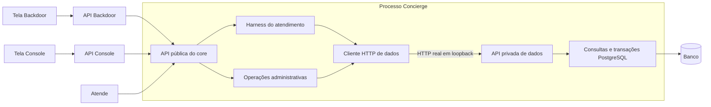

# Concierge: harness e core

Esta rodada separa o comportamento do atendimento das camadas que o conectam a HTTP, banco e integrações. Os módulos continuam no mesmo processo Concierge, dentro do monorepo com três aplicações. Não há um quarto app ou um serviço adicional para subir.

**Estado: implementação e validação local concluídas**, na branch `feat/separacao-harness-core`, criada de `feat/separacao-aplicacoes` em `c60bbea`. O teste manual com serviços reais aguarda a próxima rodada. A suíte global conserva seis falhas comprovadamente anteriores ao refactor; veja [VALIDACAO-HARNESS-CORE.md](VALIDACAO-HARNESS-CORE.md).

## Responsabilidades

| Módulo | Responsabilidade |
|---|---|
| `internal/harness` | Comportamento da conversa: coordenação, agentes, contexto, sessões em uso, memória, pedidos, ferramentas e regras de atendimento. Define os contratos de que precisa. |
| `internal/core` | Conexões com o mundo: entrada HTTP, APIs, clientes de dados e integrações, persistência, entrega de mensagens, administração e infraestrutura. Implementa os contratos consumidos pelo harness. |
| `apps/concierge/cmd` | Entradas dos executáveis Concierge e CLI. A entrada do servidor delega a composição a `internal/core/api/concierge`, que configura os adaptadores, inicia os listeners e injeta as dependências. |
| `apps/backdoor` e `apps/console` | Frontend e API próprios. Consomem o Concierge por HTTP. Guia de execução: [separação das aplicações](SEPARACAO-APLICACOES.md). |

O harness decide como o atendimento avança. O core executa a consulta, gravação ou comunicação solicitada. Mover um arquivo para uma pasta não basta para estabelecer essa fronteira: os contratos do harness também precisam deixar de conhecer SQL, conexões e clientes concretos.

## Caminho dos dados

A API privada chama os stores locais que implementam as operações de dados. O cliente não recebe uma conexão, um callback SQL ou um handler para executar em memória. Retenção de auditoria, leitura de configuração, catálogo e credenciais de entrega também passam por capacidades HTTP específicas. Migrations, seed, materialização inicial e importação de infraestrutura permanecem no core.

As chamadas LLM, MCP, Nexus e entrega de mensagens usam contratos consumidos pelo harness e adaptadores do core. Elas mantêm seus protocolos próprios; a API de dados atende persistência e consultas internas.

## Acesso e escopo

A API de dados escuta somente em loopback, em porta alocada pelo processo. A composição gera uma credencial efêmera mantida em memória. Ela não é publicada pelos proxies visuais nem distribuída ao navegador ou CLI.

Autenticar o serviço não elimina a autorização da operação. O servidor valida empresa Nexus, UUID do canal, condomínio ERP e contato conforme o contrato. Empresa Nexus, empresa Gruvi e account Nexus continuam sendo identificadores diferentes.

O acesso reservado ao webhook tem credencial própria. O core resolve o canal e verifica a assinatura HMAC; o harness recebe metadados sem chave de API ou segredo do webhook. As leituras de casos validam novamente o vínculo empresa/canal.

Operações administrativas precisam preservar a identidade autenticada e suas permissões. Um alvo informado no corpo ou um booleano de administrador não concede acesso. O CLI conectado usa operação pública autenticada; o modo offline continua baseado em arquivos e mocks.

A propagação administrativa usa prova de identidade emitida somente depois da autenticação pública, assinada com chave efêmera do processo e limitada por propósito e validade. O servidor privado verifica a prova e recarrega as atribuições locais do usuário, usando a implantação configurada no servidor. O runtime e os proxies não recebem a autoridade emissora. As operações administrativas reaplicam sua permissão e seu escopo no servidor de dados, inclusive regras, histórico e catálogo.

Sessões, memória e carteira administrativas já usam HTTP. A API confere o alvo e recarrega as permissões a cada operação. A integração autenticada por chave tem prova com propósito próprio, limitada às operações existentes de memória e leitura de pedidos; ela não representa um usuário nem concede escrita de pedidos.

O CLI conectado consulta `GET /api/runtime/configuracao` pela API pública, sem abrir banco ou receber credencial interna. Como a resposta contém o catálogo técnico completo, o endpoint exige `studio.avancado` no escopo global da Superlógica. O cliente envia credenciais somente ao Concierge local na porta 8090 (`localhost`, `127.0.0.1` ou `::1`) e recusa redirects. `-api-url` ou `CONCIERGE_API_URL` definem a base; `CONCIERGE_TOKEN` e `AUTH_DEV_USUARIO` usam a autenticação pública atual. Destinos remotos autenticados não fazem parte desse contrato local. O modo offline continua usando arquivos e mocks.

## Gravação coordenada do turno

Quando o atendimento já agrupava sessão, carteira de pedidos e auditoria, a API mantém uma única operação e uma única transação PostgreSQL. O servidor confirma sucesso depois do commit. A operação valida a correspondência entre snapshot, colunas, empresa, canal, condomínio e contato.

Locks, cancelamentos, histórico em uso e coordenação de persistência continuam no harness. Apenas a representação persistível da sessão atravessa HTTP. O envio de mensagens e as ações externas permanecem fora da transação do banco.

| Resultado | Significado e reação |
|---|---|
| Aplicada | Commit confirmado e resposta válida recebida; o consumidor confirma o estado local. |
| Não aplicada | Há prova de recusa anterior à gravação ou rollback integral. O fallback depende da causa e da semântica existente. |
| Incerta | A resposta se perdeu, houve timeout ou não foi possível provar o resultado. Não repetir automaticamente nem gravar as partes por fallback. |

Uma recusa de escopo impede gravações parciais e permite uma operação válida posterior. A quarentena é exclusiva de resultado incerto, por empresa/telefone e sobreposição de condomínio, respeitando a carteira compartilhada entre canais.

O UUID de operação serve para correlação. Sem registro durável de idempotência, ele não autoriza repetição segura. O cliente recusa redirects e não utiliza `Idempotency-Key`. Esta rodada preserva o schema existente.

## Prazo e ciclo de vida

As operações implementadas de turno e leitura de canais têm prazo de três segundos, inclusive quando o chamador não fornece um prazo. Timeout de escrita continua sendo resultado incerto. A gravação coordenada aceita até 64 MiB; a consulta de canais usa corpo limitado e resposta com tamanho máximo, sem truncar silenciosamente.

O conteúdo publicado é relido por HTTP no escopo do canal a cada turno, com prazo de três segundos. A carga inicial de regras usa HTTP com prazo de cinco segundos; as escritas confirmadas no mesmo processo notificam explicitamente o único índice em memória. A consulta pública do CLI tem prazo de trinta segundos e resposta limitada a 64 MiB.

A ordem de inicialização é: banco e preparação de infraestrutura, API privada de dados, consumidores e aquecimento, API pública pronta. A readiness pública observa a disponibilidade do listener privado.

No encerramento, o processo para novas entradas, aguarda os turnos e extrações pendentes, fecha a API de dados e por último fecha o banco.

## Condição de conclusão

- Runtime, administração, jobs e CLI conectado usam HTTP para todo consumo operacional de dados persistidos.
- Somente implementações de dados e ferramentas de infraestrutura do core conhecem a conexão e executam SQL.
- O harness não depende de banco ou clientes concretos, inclusive por imports transitivos.
- Conteúdo e regras continuam sendo atualizados nos turnos conforme as garantias existentes; há uma única coordenação do estado vivo.
- Rotas públicas, prompts, regras de negócio e schema permanecem compatíveis.
- Configurações, geradores, scripts, documentação e validações correspondem aos caminhos finais.

O acompanhamento dos marcos, comandos e limitações fica em [CONTINUIDADE.md](CONTINUIDADE.md). A validação usa integrações simuladas e PostgreSQL descartável; o teste manual com serviços externos é uma etapa combinada separadamente.
